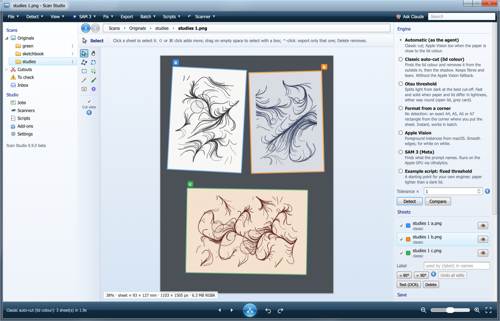
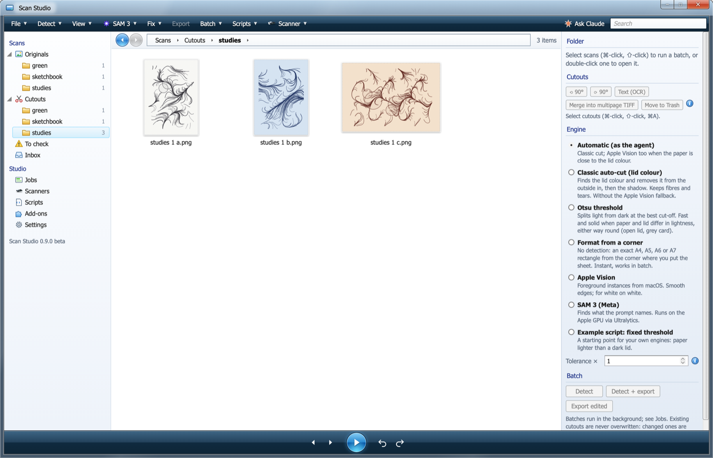
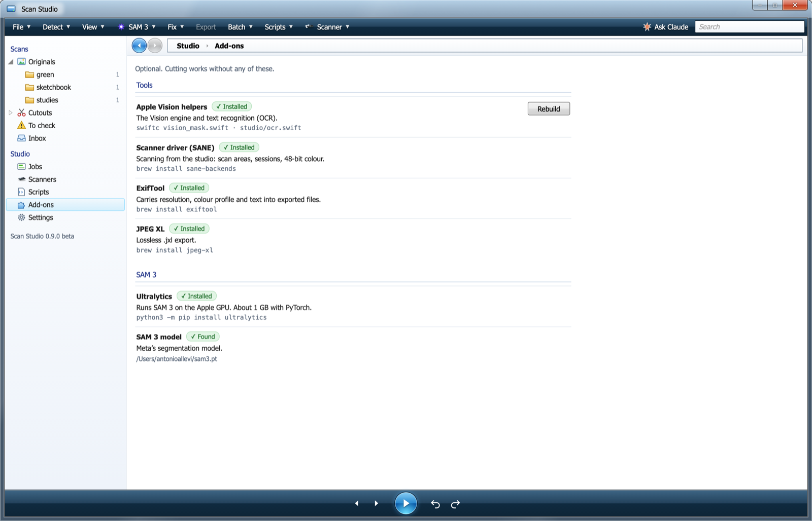
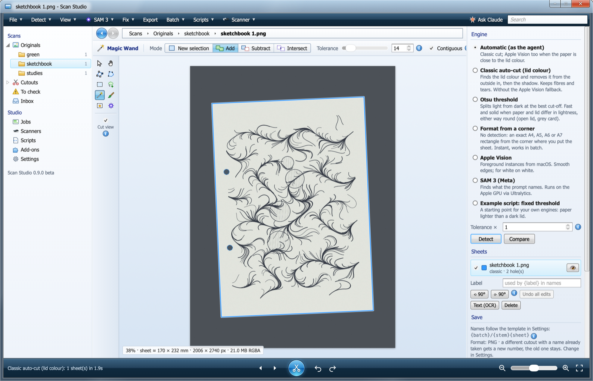

<p align="center"></p>

<h1 align="center">scancut · Scan Studio</h1>

<p align="center">Cuts scanned drawings out of flatbed scans, one transparent PNG per sheet, and gives you a window to check and fix every edge.<br><b>Beta 0.10</b> · macOS</p>



<p align="center"><a href="https://github.com/aallevi/scancut/releases/download/v0.9.0-beta/scan-studio-reel.mp4">▶ One-minute video tour (MP4)</a></p>

I scan lots of drawings and sketchbook pages and wanted the paper out of the scan with its real
edge: fibres, tears and punch holes included, nothing painted in. scancut does that automatically
for every scan that lands in a folder. Scan Studio is the window around it: you can see what was cut, fix it by hand or with an AI model, and drive the scanner.

## Features

- **Automatic cutting**: drop scans in `~/Scans/inbox`; each sheet comes out as its own transparent
  PNG, straightened, with punch holes made transparent. Several sheets on one scan are split apart.
- **Only real pixels**: cutouts change transparency only. Originals are never touched, cutouts
  never overwritten (a changed one gets ` (2)`).
- **Editor**: points, polygon, rectangle, lasso, brush and a Photoshop-style Magic Wand (new, add,
  subtract, intersect), with history. It also has a densitometer, a loupe and a histogram.
- **Engines**: the classic lid-colour cut, Otsu threshold, exact paper formats from a corner,
  Apple Vision, Meta **SAM 3** (optional) and your own Python scripts.
- **Library**: every scan, part, cut and text lives in one catalog (`Library.DocuLib`, SQLite) with
  checksums, history and snapshots. Each part's characteristics are stored once: change the outline,
  rotation, name or text anywhere and its cut and every view follow. **Move files in…** puts originals
  and cuts inside the library as lossless JPEG XL (same pixels, checked; about 40% of a TIFF).
- **Text**: Apple Vision or a local model (GLM-OCR, Qwen3-VL) reads the parts; the text stays editable,
  with versions, and is written into each cut's metadata.
- **Scanning**: scan areas, 48-bit colour, page-by-page sessions (Space or a timer) through SANE;
  each page is filed into the library at once.
- **Cut**: PNG or lossless JPEG XL, 16-bit kept, true size (dpi) and colour profile carried over,
  text in the metadata, lossless 90° rotation, multipage TIFF, optional Eagle import.



## Install

You need macOS 13 or later, the Xcode command-line tools (`xcode-select --install`) and Python 3.10
or later (`brew install python`). Apple silicon is recommended for SAM 3.

```sh
git clone https://github.com/aallevi/scancut.git
cd scancut
./install.sh --agent --tools
```

| Option | What it does |
|---|---|
| *(none)* | Python environment in `.venv`, Apple Vision helpers, **Scan Studio** in `~/Applications` |
| `--agent` | Also cut every scan that lands in `~/Scans/inbox` (a LaunchAgent, runs in the background) |
| `--tools` | Also the Homebrew tools: SANE scanner driver, ExifTool, JPEG XL |
| `--root DIR` | Use another scans folder instead of `~/Scans` |
| `--python PATH` | Use an existing Python that has numpy, OpenCV, Pillow and tifffile |

Run it again after `git pull`. Everything optional can also be added later from the app, under
**Studio › Add-ons**.

### SAM 3 (optional)

Add-ons installs Ultralytics with one click. The model itself (3.5 GB) is licence-gated by Meta:
request access on [huggingface.co/facebook/sam3](https://huggingface.co/facebook/sam3). Once
access is granted, paste a read token in Add-ons and download. You can also download `sam3.pt`
yourself and leave it in `~/Downloads`; it is found there.



## Usage

1. **Scan** into `~/Scans/inbox`: with Image Capture, your scanner's own app, or from the
   **Scanners** page. Grey card behind white paper gives the cleanest edges.
2. The agent files each scan in `originals/<series>/` and writes the cuts to `cut/<series>/`
   (inside `Library.DocuLib` once the files are moved in). Scans it is unsure about also appear
   under **To check**.
3. In Scan Studio, open a scan to see its parts. Press **Detect** to try another engine, fix
   edges with the tools on the left, and **Cut** (⌘S). From then on the cuts follow their parts.
4. **Library** shows sources, cuts and texts; **Check** proves every file and cut is where the
   catalog says and unchanged.

The series is the file name without its final number: `sketchbook 12.png` goes to `sketchbook/`.

| Shortcut | |
|---|---|
| V · H (or Space) · A | select · pan · edit points |
| P · M · L · W · B | polygon · rectangle · lasso · Magic Wand · brush |
| X, or ⌥ while clicking | swap add / cut |
| ⌘-click · ⇧-click · ⌃-click | add a part · add a range · cut only this part |
| O · G · C | cut view · loupe · compare engines |
| ⌘Z · ⇧⌘Z · ⌘S · ⌘0 · ⌘1 | undo · redo · cut · fit · actual pixels |



From a terminal, without the window:

```sh
.venv/bin/python3 -I studio.py detect originals/sketchbook --engine classic --export
.venv/bin/python3 -I scancut.py ~/Scans        # one run of the agent by hand
```

## More

- [STUDIO.md](STUDIO.md): engines, how edits are stored, the local API, testing.
- [docs/LIBRARY.md](docs/LIBRARY.md): the library: what it stores, the one-source rule, files inside.
- [docs/DATABASE.md](docs/DATABASE.md): the database map: tables, parts as items, texts, the archive (Directus) alignment.
- [CLAUDE.md](CLAUDE.md): how the automatic cut works, step by step, and the rules it keeps.

## Licence

MIT, see [LICENSE](LICENSE). Optional parts keep their own licences and are installed by you,
never bundled: Ultralytics (AGPL-3.0), SAM 3 (Meta's SAM licence), SANE, ExifTool, libjxl.
